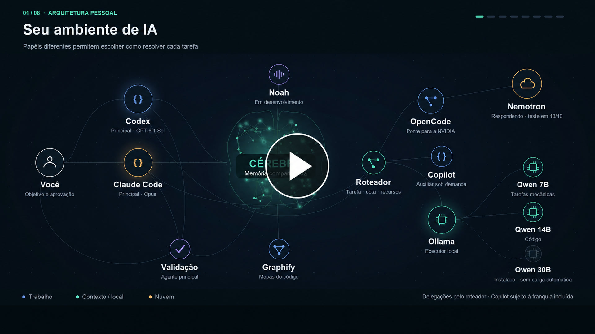
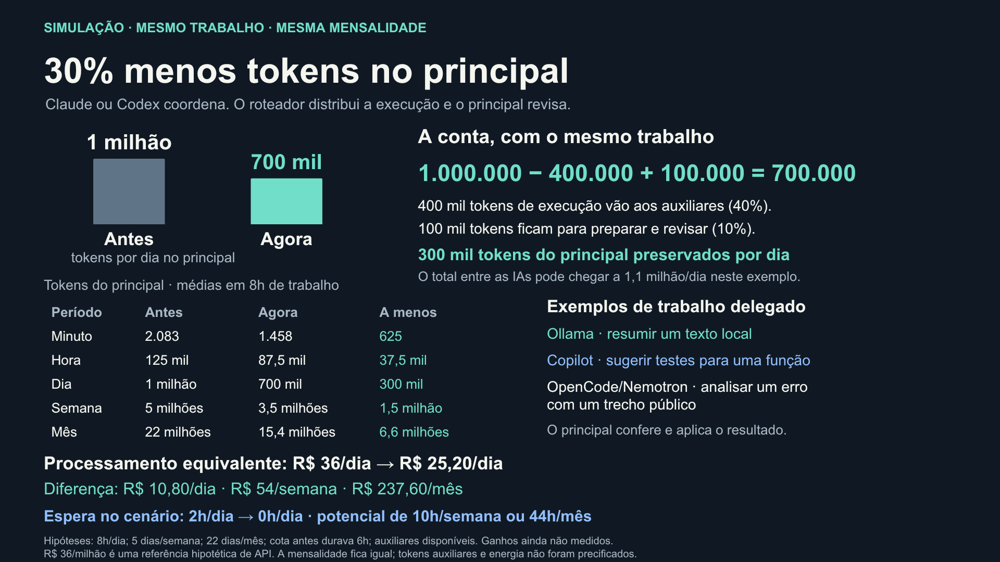
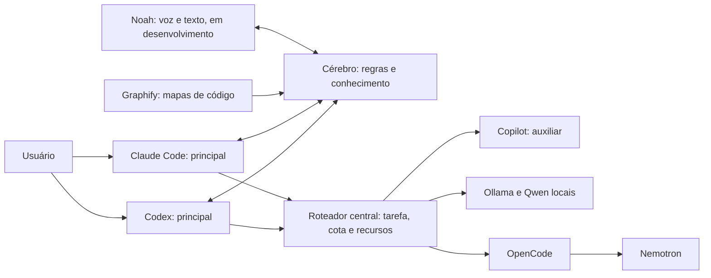

# Cérebro

O Cérebro reúne regras, contexto de projetos, decisões e aprendizados em arquivos Markdown locais. Agentes de programação consultam os trechos relevantes antes de trabalhar e registram o que foi verificado, para que a próxima sessão possa retomar de onde a anterior parou.

Esta edição pública contém ferramentas, um cofre sintético de exemplo, documentação e o vídeo da arquitetura. O cofre pessoal, os backups reais, credenciais, configurações de contas e referências de voz ficam fora do repositório.

## Vídeo da arquitetura

O vídeo usa a voz do Noah para mostrar o fluxo: o agente principal consulta o Cérebro, delega pelo roteador e revisa o resultado. É uma ilustração do funcionamento, sem representar telemetria de mensagens reais.

[](https://nicholasbirochi.github.io/Cerebro/)

**[▶ Abrir o player (3min18s)](https://nicholasbirochi.github.io/Cerebro/)** · [Baixar o vídeo](https://github.com/nicholasbirochi/Cerebro/raw/refs/heads/main/media/arquitetura.mp4)

O vídeo só começa quando você clica em Play. O player oferece pausa, barra de tempo para avançar ou voltar, volume e tela cheia. A capa acima é estática; o MP4 original, com narração, foi mantido.

## Benchmark ampliado: 10.000 notas e 26,9 milhões de caracteres

[](media/one-pager.png)

[Ampliar o one pager](media/one-pager.png) · [Baixar o slide editável (PowerPoint)](media/one-pager.pptx)

Análise com dados **inteiramente sintéticos**, em três escalas: 40, 1.000 e 10.000 notas de conteúdo. O maior acervo tem **26.918.974 caracteres**, mais de 28 MB em UTF-8, incluindo um protocolo mínimo. São oito consultas distintas por escala, cobrindo temas, múltiplos termos, filtro de projeto e ausência de resultado: **24 comparações e 48 execuções**.

| Escala | Texto retornado antes | Agora | Redução |
|---|---:|---:|---:|
| 40 notas, 8 consultas | 44.547 | 37.155 | 16,6% |
| 1.000 notas, 8 consultas | 82.546 | 40.565 | 50,9% |
| 10.000 notas, 8 consultas | 83.872 | 40.579 | 51,6% |
| **Total de 24 consultas** | **210.965** | **118.299** | **43,9%** |

**Mesmas notas e trechos em todas as comparações**, com o mesmo limite de cinco notas e 12.000 caracteres por consulta. Os totais acima somam saídas de consultas distintas. O tamanho do acervo é contado separadamente e não representa conteúdo inteiro enviado à IA.

### Reproduzir a análise

```bash
python3 tools/benchmark_busca.py --ampliado
```

[Método e limites](docs/BENCHMARK.md) · [Resultados completos, consultas, hashes e tempos observados](docs/benchmark-ampliado.json). O comando sem `--ampliado` mantém o exemplo rápido original de 40 notas. A medição local anterior de 60,9% pertence a uma consulta específica e não é extrapolada para esta bateria. Caracteres de saída não medem tokens totais, produtividade ou economia financeira. O acervo pessoal não é distribuído.

## Arquitetura de delegação



Claude Code e Codex são entradas alternativas. O desenho apresenta a arquitetura-alvo definida pelo usuário: toda delegação passa pelo roteador, que escolhe Copilot, Ollama ou OpenCode/Nemotron conforme a tarefa, a franquia disponível e os recursos locais. A resposta retorna ao principal escolhido para revisão.

**Estado da implementação:** `tools/auxiliares.py` reúne Copilot, Ollama e Nemotron via OpenCode. São três destinos na mesma camada de auxiliares. O principal decide quando delegar; o script escolhe o destino elegível e devolve a resposta para revisão. O hook orienta o agente a usar o roteador e não intercepta automaticamente cada mensagem do chat.

Codenotch fica fora do mapa de mensagens. Monitoramento de consumo é uma camada separada e não encaminha as tarefas. O vídeo não afirma cobertura de provedores que não foi verificada.

## Experimentar sem acessar um cofre pessoal

Python 3.12+ é recomendado para executar todas as ferramentas e testes. O núcleo usa somente a biblioteca padrão; os arquivos usam UTF-8. O executor de auxiliares usa `fcntl` e o mecanismo de backup identifica discos no macOS; não foi validado no Windows.

```bash
python3 tools/cerebro.py contexto --cwd "$PWD"
python3 tools/cerebro.py buscar regras --trechos
python3 tools/cerebro.py verificar
python3 -m unittest discover -s tools -p 'test_*.py' -q
```

O padrão desta distribuição é `examples/cofre`. Para usar seu próprio cofre privado, configure `CEREBRO_DIR` com um caminho absoluto fora do repositório público. As atualizações de notas existentes exigem o hash lido anteriormente e usam trava e escrita atômica.

### Contexto em camadas

`buscar --trechos` começa com até duas notas e 2.500 caracteres de saída total. Notas omitidas aparecem em uma contagem, sem uma lista longa de nomes. Use `--projeto` quando souber o projeto; leia primeiro o estado atual e a rota da tarefa no mapa.

```bash
python3 tools/cerebro.py buscar regras --trechos
# Amplie se a primeira consulta não trouxer informação suficiente:
python3 tools/cerebro.py buscar regras --trechos --max 5 --orcamento 12000
```

O modo sem `--trechos` preserva o padrão anterior de cinco notas e 12.000 caracteres de conteúdo selecionado. Os limites são de caracteres, não uma medição de tokens ou economia de assinatura. [Rotas por tarefa e monitoramento dos mapas](docs/ARQUITETURA.md#mapas-e-contexto-em-camadas) completam a navegação sem carregar o histórico inteiro.

A busca ignora acentos e caixa, trata termos de até três caracteres como palavras inteiras e reconhece os aliases explícitos `edita`/`editar`/`modifica`/`modificar`. Termos maiores mantêm a busca parcial. Seções de estado atual recebem preferência; o histórico continua pesquisável. Isso melhora a seleção local e não altera a fase declarada de um projeto.

## Auxiliares

`tools/auxiliares.py` prefere Qwen 7B para tarefas mecânicas, Copilot elegível para código e Nemotron elegível para análise; sem esses acessos, considera os modelos locais adequados já residentes, incluindo Qwen 14B para código. O 30B não é carregado automaticamente. O Ollama e os modelos precisam estar instalados pelo usuário; o script não baixa modelos.

Na máquina apresentada, o Nemotron respondeu via OpenCode em 13/10/2026: 56 tokens de entrada, 2 de saída e cerca de 19 segundos. Isso confirma a chamada nessa data; conexão, credencial e cota continuam necessárias.

A distribuição pública mantém a rota remota desativada no exemplo, pois não inclui credenciais nem o perfil privado do OpenCode. O uso de Nemotron depende de acesso gratuito elegível, credencial local e perfil isolado do OpenCode; autenticação e perfis privados não são distribuídos aqui. Não há fallback para um endpoint pago. Os testes simulam os serviços e não fazem inferência real.

Copilot foi validado pelo roteador em 14/10/2026 com entrada pública mínima, uma inferência e nenhuma ferramenta. Para habilitá-lo, instale o Copilot CLI e o GitHub CLI, autentique sua conta e defina `copilot_habilitado: true` em `tools/auxiliares.json`. O exemplo público começa desativado. A cada seleção o roteador exige pelo menos 30 créditos incluídos disponíveis e cobrança excedente desativada. Usa Auto/Efficiency em perfil temporário isolado, sem instruções do projeto, MCP ou ferramentas. O limite de sessão de 30 créditos é um soft cap, e não garantia de gasto máximo. Erros depois da chamada não iniciam nova tentativa nem fallback. O CLI reporta modelo efetivo e tokens; a franquia incluída não é acesso ilimitado.

A entrada é texto por stdin: `python3 tools/auxiliares.py --tipo codigo --provedor copilot`. Forneça somente um trecho permitido e delimitado. O principal continua responsável por revisão e aplicação.

## Backup e restauração

`tools/backup_cerebro.py` gera arquivo datado, hashes e manifesto e testa a restauração numa pasta temporária. A pasta de saída precisa ficar fora do cofre. O manifesto diferencia mesmo disco físico, outro disco e resultado indeterminado.

Uma pasta sincronizada no mesmo disco não representa independência física. Para comprovar recuperação pela nuvem, valide uma cópia efetivamente baixada do serviço, conferindo integridade e restauração.

## Privacidade

Use o repositório como distribuição de ferramentas, mantendo o cofre pessoal separado. A lista de arquivos permitidos no `.gitignore` ajuda a impedir o envio acidental de notas, arquivos compactados, bases de dados ou amostras de voz. Uma revisão do conteúdo continua necessária antes de cada publicação.

## Licença

O código e a documentação originais deste projeto estão disponíveis sob a [licença MIT](LICENSE). Referências a serviços, ferramentas e modelos de terceiros seguem as condições dos respectivos fornecedores.
