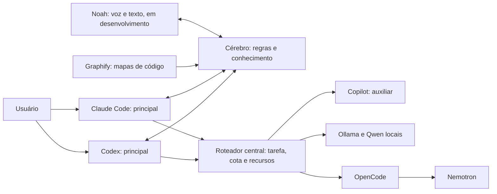

# Cérebro

Sistema local de conhecimento compartilhado entre agentes de programação. Regras, contexto de projetos, decisões e aprendizados ficam em arquivos Markdown; as ferramentas consultam trechos relevantes e registram conhecimento verificável.

Esta edição pública contém ferramentas, um cofre sintético de exemplo, documentação e o vídeo da arquitetura. O cofre pessoal, os backups reais, credenciais, configurações de contas e referências de voz ficam fora do repositório.

## Arquitetura de delegação



Claude Code e Codex são entradas alternativas. O desenho apresenta a arquitetura-alvo definida pelo usuário: toda delegação passa pelo roteador, que escolhe Copilot, Ollama ou OpenCode/Nemotron conforme a tarefa, a franquia disponível e os recursos locais. A resposta retorna ao principal escolhido para revisão.

**Estado da implementação:** `tools/auxiliares.py` reúne Copilot, Ollama e Nemotron via OpenCode. São três destinos na mesma camada de auxiliares. O principal decide quando delegar; o script escolhe o destino elegível e devolve a resposta para revisão. O hook orienta o agente a usar o roteador e não intercepta automaticamente cada mensagem do chat.

Codenotch fica fora do mapa de mensagens. Monitoramento de consumo é uma camada separada e não encaminha as tarefas. O vídeo não afirma cobertura de provedores que não foi verificada.

[Assistir ao vídeo da arquitetura](media/arquitetura.mp4)


[One pager editável](media/one-pager.pptx). O cenário de 30% é ilustrativo: não mede economia observada, desconto na mensalidade nem espera real por cota.

## Experimentar sem acessar um cofre pessoal

Python 3.12+ é recomendado para executar todas as ferramentas e testes. O núcleo usa somente a biblioteca padrão; os arquivos usam UTF-8. O executor de auxiliares usa `fcntl` e o mecanismo de backup identifica discos no macOS; não foi validado no Windows.

```bash
python3 tools/cerebro.py contexto --cwd "$PWD"
python3 tools/cerebro.py buscar regras --trechos
python3 tools/cerebro.py verificar
python3 -m unittest discover -s tools -p 'test_*.py' -q
```

O padrão desta distribuição é `examples/cofre`. Para usar seu próprio cofre privado, configure `CEREBRO_DIR` com um caminho absoluto fora do repositório público. As atualizações de notas existentes exigem o hash lido anteriormente e usam trava e escrita atômica.

## Auxiliares

`tools/auxiliares.py` prefere Qwen 7B para tarefas mecânicas, Copilot elegível para código e Nemotron elegível para análise; sem esses acessos, considera os modelos locais adequados já residentes, incluindo Qwen 14B para código. O 30B não é carregado automaticamente. O Ollama e os modelos precisam estar instalados pelo usuário; o script não baixa modelos.

Na máquina apresentada, o Nemotron respondeu via OpenCode em 13/10/2026: 56 tokens de entrada, 2 de saída e cerca de 19 segundos. Isso confirma a chamada nessa data; conexão, credencial e cota continuam necessárias.

A distribuição pública mantém a rota remota desativada no exemplo, pois não inclui credenciais nem o perfil privado do OpenCode. O uso de Nemotron depende de acesso gratuito elegível, credencial local e perfil isolado do OpenCode; autenticação e perfis privados não são distribuídos aqui. Não há fallback para um endpoint pago. Os testes simulam os serviços e não fazem inferência real.

Copilot foi validado pelo roteador em 14/10/2026 com entrada pública mínima, uma inferência e nenhuma ferramenta. Para habilitá-lo, instale o Copilot CLI e o GitHub CLI, autentique sua conta e defina `copilot_habilitado: true` em `tools/auxiliares.json`. O exemplo público começa desativado. A cada seleção o roteador exige pelo menos 30 créditos incluídos disponíveis e cobrança excedente desativada. Usa Auto/Efficiency em perfil temporário isolado, sem instruções do projeto, MCP ou ferramentas. O limite de sessão de 30 créditos é um soft cap, e não garantia de gasto máximo. Erros depois da chamada não iniciam nova tentativa nem fallback. O CLI reporta modelo efetivo e tokens; a franquia incluída não é acesso ilimitado.

A entrada é texto por stdin: `python3 tools/auxiliares.py --tipo codigo --provedor copilot`. Forneça somente um trecho permitido e delimitado. O principal continua responsável por revisão e aplicação.

## Backup e restauração

`tools/backup_cerebro.py` gera arquivo datado, hashes e manifesto e testa a restauração numa pasta temporária. A pasta de saída precisa ficar fora do cofre. O manifesto diferencia mesmo disco físico, outro disco e resultado indeterminado.

Uma pasta sincronizada no mesmo disco não representa independência física. Para comprovar recuperação pela nuvem, valide uma cópia efetivamente baixada do serviço, conferindo integridade e restauração.

## Privacidade

Use o repositório como distribuição de ferramentas, mantendo o cofre pessoal separado. A lista de arquivos permitidos no `.gitignore` ajuda a impedir o envio acidental de notas, arquivos compactados, bases de dados ou amostras de voz. Uma revisão do conteúdo continua necessária antes de cada publicação.
