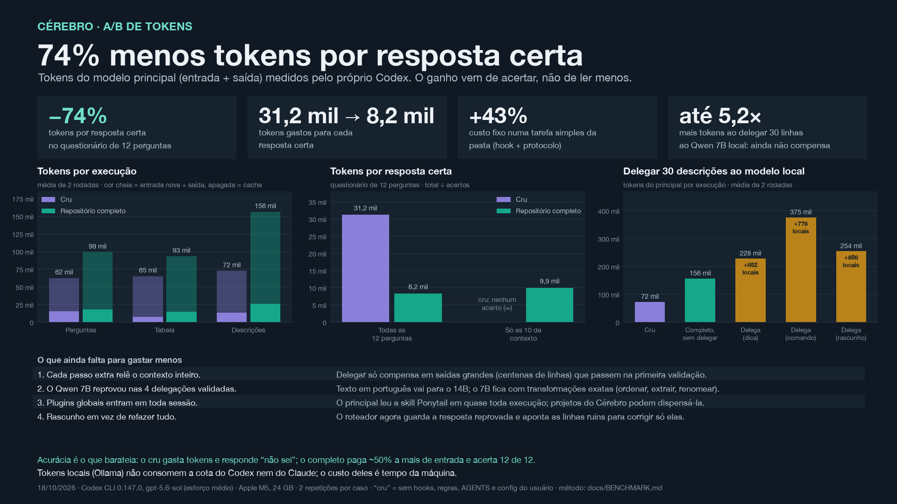

# A/B: Codex cru × repositório completo

Mesmo modelo, mesma pasta e mesmas tarefas, em duas condições. Só muda o ambiente em volta do agente.

| Condição | O que o Codex recebe |
|---|---|
| **Cru** | `codex exec --ignore-user-config --ignore-rules -c project_doc_max_bytes=0 --disable hooks`: sem configuração do usuário, regras, AGENTS, hooks, skills ou Cérebro. O prompt pede que use só o próprio conhecimento e os arquivos da pasta. |
| **Repositório completo** | Configuração normal: hook de início do Cérebro, Protocolo dos Agentes, busca com trechos e roteador `auxiliares.py` para Ollama, Copilot e Nemotron. |

Ambiente: 18/10/2026, Codex CLI 0.147.0, `gpt-5.6-sol` com esforço médio, Apple M5 com 24 GB, 2 repetições por caso. Os tokens do principal (entrada, entrada em cache e saída) vêm dos eventos `turn.completed` do próprio Codex; os tokens locais vêm do registro do roteador.

## Acurácia

| Tarefa | Cru | Completo |
|---|---:|---:|
| 10 perguntas que dependem do contexto do usuário (2 rodadas) | 0/20 | 20/20 |
| 2 perguntas respondíveis pelos arquivos da pasta | 4/4 | 4/4 |
| Tabela Markdown a partir de `dados.txt` | 2/2 | 2/2 |
| 30 descrições curtas (formato conferido) | 2/2 | 2/2 |
| Tempo médio do questionário | 12,4 s | 25,8 s |

O cru respondeu "não sei" nas perguntas de contexto e não inventou respostas. As tarefas que dependem só da pasta não pioraram com o repositório.

## Tokens

| Medida (média de 2 rodadas) | Cru | Completo |
|---|---:|---:|
| Tokens do principal, questionário | 62 mil | 99 mil |
| Tokens do principal, tabela | 65 mil | 93 mil |
| Tokens do principal, 30 descrições | 72 mil | 156 mil |
| Tokens por resposta certa, questionário | 31,2 mil | 8,2 mil |

O repositório completo **lê mais** em cada sessão (+43% a +117%, quase todo em cache) e por isso **gasta 74% menos tokens por resposta certa**: o cru gasta tokens e não acerta o que depende do contexto.

**Delegar ao modelo local ainda não compensa em tarefas pequenas.** Nas 30 descrições, a delegação ao Qwen 2.5 Coder 7B elevou os tokens do principal para 228 mil (dica), 375 mil (comando) e 254 mil (rascunho), contra 156 mil sem delegar. O 7B foi reprovado na validação de formato nas 4 delegações validadas, e o principal reler o contexto a cada passo custa mais do que as 30 linhas economizadas. O fluxo de rascunho, que guarda a resposta reprovada e aponta só as linhas ruins, reduziu o custo de 375 mil para 254 mil.

O que vem a seguir:

1. Delegar só saídas grandes (centenas de linhas) que passem na primeira validação.
2. Texto em português vai para o 14B; o 7B fica com transformações exatas (ordenar, extrair, renomear).
3. Evitar plugins globais em projetos do Cérebro; o principal leu a skill Ponytail em quase toda execução.
4. Corrigir rascunhos em vez de refazer a tarefa.

## Limites

- 2 repetições por caso; diferenças pequenas de tempo e tokens estão dentro da variação.
- Só o Codex foi testado. O Claude Code não entrou nesta rodada.
- A correção é automática: e-mail, pasta e comando por expressão regular, tabela linha a linha e descrições só no formato, não na qualidade do texto.
- As perguntas de contexto foram escritas a partir do cofre pessoal e não são distribuídas; o cru não tinha como acertá-las, e é isso que o teste mostra: o ganho vem do contexto, não do modelo.
- Tokens locais (Ollama) não consomem a cota do Codex nem do Claude; o custo deles é tempo de máquina.
