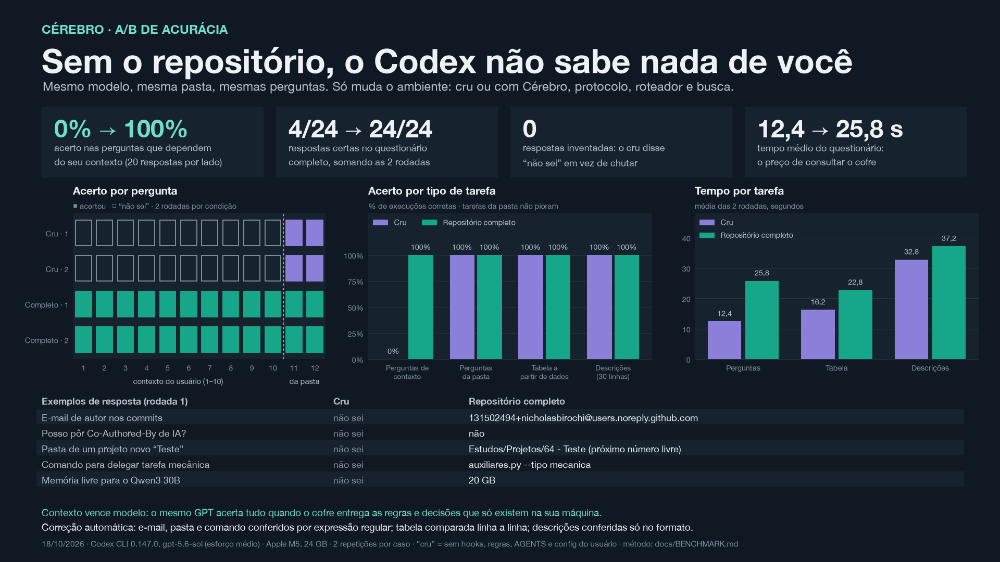
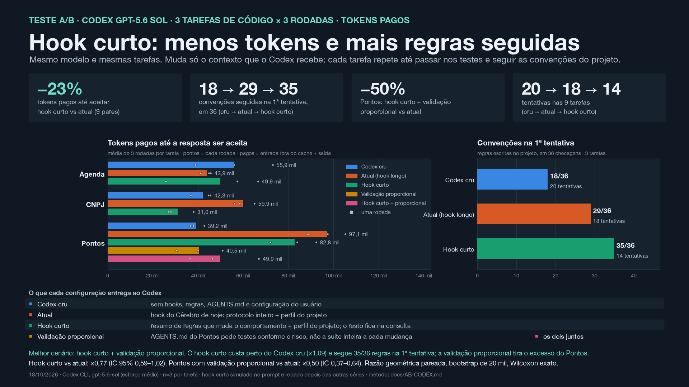
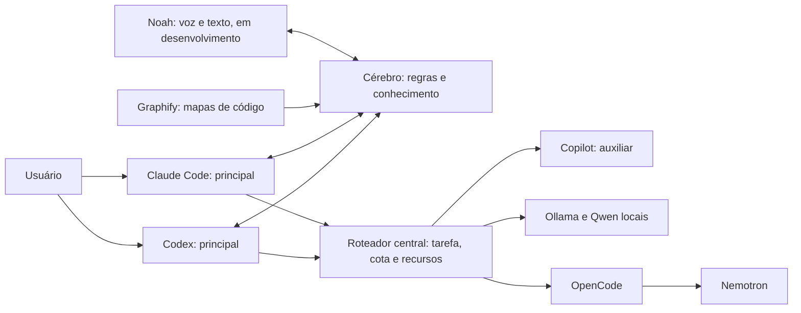

# Cérebro

O Cérebro reúne regras, contexto de projetos, decisões e aprendizados em arquivos Markdown locais. Agentes de programação consultam os trechos relevantes antes de trabalhar e registram o que foi verificado, para que a próxima sessão possa retomar de onde a anterior parou.

Esta edição pública contém ferramentas, um cofre sintético de exemplo, documentação e o vídeo da arquitetura. O cofre pessoal, os backups reais, credenciais, configurações de contas e referências de voz ficam fora do repositório.

## Vídeo da arquitetura

O vídeo usa a voz do Noah para mostrar o fluxo: você define o objetivo, o agente principal consulta o Cérebro, delega pelo roteador aos auxiliares e revisa o resultado. É uma ilustração do funcionamento, sem representar telemetria de mensagens reais.

[](https://nicholasbirochi.github.io/Cerebro/)

**[▶ Abrir o player (2min12s)](https://nicholasbirochi.github.io/Cerebro/)** · [Baixar o vídeo](https://github.com/nicholasbirochi/Cerebro/raw/refs/heads/main/media/arquitetura.mp4)

O vídeo só começa quando você clica em Play. O player oferece pausa, barra de tempo para avançar ou voltar, volume e tela cheia. No GitHub a capa é uma imagem: clique no play dela para abrir o player. O MP4 original, com narração, foi mantido.

## A/B: Codex cru × repositório completo

Mesmo modelo, mesma pasta e mesmas perguntas. O Codex **cru** roda sem configuração, regras, AGENTS, hooks ou Cérebro; o **completo** usa o hook, o protocolo, a busca e o roteador local.

[](media/ab-acuracia.png)

Nas perguntas que dependem do seu contexto, o acerto foi de **0 para 120 em 120** (6 rodadas, 150 respostas por lado), sem regressão nas tarefas da pasta. O completo lê mais por sessão, mas gasta **49% menos tokens por resposta certa**. Delegar tarefas pequenas ao Qwen 7B local ainda custa mais ao principal do que economiza; o método, os números e os próximos ajustes estão em [docs/AB-CODEX.md](docs/AB-CODEX.md).

### Código: tokens pagos até a resposta ser aceita

[](media/ab-codigo.png)

Em três tarefas de código repetidas até serem aceitas, o hook com o protocolo inteiro custou ×1,42 os tokens pagos (entrada fora do cache + saída) do Codex cru. Um **hook curto**, só com as regras que mudam o comportamento, ficou em ×1,09 do cru e **23% abaixo do atual**. Ele também seguiu **35 de 36 convenções** na 1ª tentativa, contra 29 do atual e 18 do cru. No Pontos, pedir **validação proporcional ao risco** em vez da suíte inteira a cada passo cortou metade dos tokens pagos. O melhor cenário medido é **hook curto + validação proporcional**; n = 3 por tarefa, com intervalos e limites em [docs/AB-CODEX.md](docs/AB-CODEX.md#código-até-acertar-qual-contexto-custa-menos). **Aplicado em 18/10/2026:** o hook de início agora injeta só esse resumo (cerca de 1,9 mil caracteres, contra ~5 mil só da seção Essencial). O texto vem da seção `## Resumo do hook` do Protocolo, quando existe, ou do padrão `RESUMO` em [tools/cerebro.py](tools/cerebro.py).

## Como os testes foram feitos

Os A/B comparam o mesmo Codex (`gpt-5.6-sol`, esforço médio) em duas condições, e só o ambiente em volta dele muda:

- **Cru**: `codex exec --ignore-user-config --ignore-rules -c project_doc_max_bytes=0 --disable hooks`, ou seja, sem configuração do usuário, regras, AGENTS, hooks ou Cérebro. O prompt pede que ele use só o próprio conhecimento e os arquivos da pasta.
- **Completo**: a configuração normal da máquina, com hook de início, Protocolo dos Agentes, busca com trechos e roteador de auxiliares.

Cada execução roda numa cópia descartável, com escrita liberada só nessa pasta e sem rede. Os tokens são os que o próprio Codex informa em `turn.completed`: entrada (incluindo o cache) mais saída. O uso de modelos locais vem do registro do roteador. Se o cru executar algo que toque o Cérebro, `.codex` ou `.claude`, a execução é marcada como contaminada.

**Perguntas.** Cada rodada traz 25 perguntas, e foram 6 rodadas. Vinte dependem de regras e decisões que só existem no cofre, como o e-mail dos commits, a pasta de um projeto novo ou o modelo auxiliar. As outras 5 se respondem com os arquivos da pasta. A resposta vem em JSON e é corrigida por expressão regular; "não sei" conta como erro. Uma tarefa extra gera uma tabela Markdown, conferida linha a linha.

**Código, até acertar.** São três tarefas reais, cada uma feita numa cópia de um projeto desta máquina:

| Tarefa | Tipo | Pedido |
|---|---|---|
| CNPJ CNAE Scraper | modificar um projeto com contexto | `resumo_por_cnae(linhas)` e uma aba "Resumo" na planilha |
| Agenda | criar um projeto novo | `proximos(eventos, hoje, dias)` com testes, pronto para publicar no GitHub |
| Pontos Loop | mudar uma regra financeira | `taxa_periodo(taxa_mensal, dias)` usada em `pv` e verificada em `check()` |

Cada entrega passa por três crivos:

1. **Testes ocultos** que o Codex nunca vê: 6, 5 e 8 casos (empate na ordenação, janela inclusiva, virada de mês, `Decimal`, entrada intacta etc.), além dos testes que o projeto já tinha.
2. **Extras objetivos**: escrever testes novos e manter o `check_math.py` passando.
3. **Convenções do usuário**:
   - pasta `NN - Nome` com o próximo número livre;
   - README com imagem e `.gitignore`;
   - descrição em inglês;
   - perguntar a visibilidade e quais dados entram antes de publicar;
   - identidade humana nos commits;
   - nenhum commit em projeto existente;
   - `FORMULAS.md` atualizado;
   - retorno em `Decimal`.

A entrega é **correta** quando passa nos ocultos e nos extras, e **aceita** quando, além disso, cumpre todas as convenções. Se não for aceita, a mesma sessão é retomada (`codex exec resume`) com a revisão que um usuário faria: o nome de cada teste que falhou com a última linha do erro e uma frase para cada convenção que falta. O código dos testes nunca é mostrado. São até 5 tentativas por execução. Os tokens são somados até a tentativa correta e até a aceita, para medir **quanto custa chegar ao resultado**, não só a primeira resposta.

A checagem de testes novos no CNPJ entrou depois de uma rodada de validação, que não conta nos números. Os scripts de A/B leem o cofre pessoal e não são distribuídos; as tarefas, os crivos e as mensagens de revisão estão descritos aqui e em [docs/AB-CODEX.md](docs/AB-CODEX.md).

## Benchmark de contexto: de 1 nota a 1 milhão de notas

[](media/one-pager.png)

[Ampliar o one pager](media/one-pager.png) · [Baixar o slide editável (PowerPoint)](media/one-pager.pptx)

Análise com dados **inteiramente sintéticos** em sete escalas: 1, 10, 100, 1.000, 10.000, 100.000 e 1 milhão de notas de conteúdo, até 2,83 GB, com oito consultas distintas por escala. De 1 a 100.000 notas foram **48 comparações e 96 execuções**. Em 1 milhão de notas, o resultado é **58,2% menos tokens e 27 h → 50 min nas 8 buscas**: o acervo foi gerado em disco, as consultas 1 a 4 foram medidas nas duas versões (9,5 h → 24,8 min) e as 5 a 8 foram estimadas a partir delas¹.

| Escala | Texto retornado antes | Agora | Redução em caracteres | Redução em tokens* | 8 buscas, antes → agora |
|---|---:|---:|---:|---:|---:|
| 1 nota | 4.667 | 4.667 | 0,0% | 0,0% | 0,3 s → 0,3 s |
| 10 notas | 23.587 | 23.509 | 0,3% | 0,5% | 0,3 s → 0,3 s |
| 100 notas | 64.082 | 39.371 | 38,6% | 45,1% | 0,5 s → 0,5 s |
| 1.000 notas | 82.546 | 40.565 | 50,9% | 57,5% | 1,3 s → 1,4 s |
| 10.000 notas | 83.872 | 40.579 | 51,6% | 58,2% | 13,6 s → 10,1 s |
| 100.000 notas | 83.886 | 40.593 | 51,6% | 58,2% | 10 min → 3 min |
| 1.000.000 notas¹ | 83.900 | 40.607 | 51,6% | 58,2% | 27 h → 50 min |
| **Total medido, 48 consultas** | **342.640** | **189.284** | **44,8%** | **51,4%** | |

**Mesmas notas e trechos em todas as comparações medidas**, com o mesmo limite de cinco notas e 12.000 caracteres por consulta. Com 1 nota não há o que economizar. A redução aparece a partir de 100 notas e estabiliza entre 50,9% a 51,6% de 1.000 notas em diante, porque as duas versões atingem o mesmo teto. A economia de contexto não custou tempo: em 100.000 notas, a busca atual foi 3,8× mais rápida.

\* Tokens contados com tiktoken `o200k_base`, sem chamar API. Não é o tokenizador do Claude e mede só o texto devolvido pela busca, não a conversa inteira. Os totais somam consultas distintas, e o tamanho do acervo não representa conteúdo enviado à IA.

¹ 1 milhão de notas é o resultado final; não haverá nova medição. Buscas 1 a 4 medidas e 5 a 8 estimadas pelo fator observado nas quatro primeiras (intervalo 26–31 h e 42–57 min). Caracteres e tokens seguem a regra observada até 100.000 notas, e a equivalência das saídas não foi conferida nessa escala.

### Reproduzir a análise

```bash
python3 tools/benchmark_busca.py --ampliado
python3 tools/benchmark_busca.py --escalas 1 10 100 1000 10000 100000 --parcial progresso.json
```

O primeiro comando mede de 1 a 10.000 notas em cerca de 30 segundos. O segundo inclui 100.000 notas e pode ser retomado pelo arquivo de progresso. Há também `--completo`, que inclui 1 milhão de notas: cerca de 4 GB temporários e cerca de 29 h, com `--espera 43200`, porque uma busca da versão anterior passa de 8 h. [Método, custos e limites](docs/BENCHMARK.md) · [Resultados completos](docs/benchmark-ampliado.json) · [Ensaio anterior, de três escalas](docs/benchmark-tres-escalas-2026-10-16.json). A medição local anterior de 60,9% pertence a uma consulta específica e não é extrapolada para esta bateria. O acervo pessoal não é distribuído.

## Arquitetura de delegação



Claude Code e Codex são entradas alternativas. O desenho apresenta a arquitetura-alvo definida pelo usuário: toda delegação passa pelo roteador, que escolhe Copilot, Ollama ou OpenCode/Nemotron conforme a tarefa, a franquia disponível e os recursos locais. A resposta retorna ao principal escolhido para revisão.

**Estado da implementação:** `tools/auxiliares.py` reúne Copilot, Ollama e Nemotron via OpenCode. São três destinos na mesma camada de auxiliares. O principal decide quando delegar; o script escolhe o destino elegível e devolve a resposta para revisão. O hook orienta o agente a usar o roteador e não intercepta automaticamente cada mensagem do chat.

Codenotch fica fora do mapa de mensagens. Monitoramento de consumo é uma camada separada e não encaminha as tarefas. O vídeo não afirma cobertura de provedores que não foi verificada.

## Experimentar sem acessar um cofre pessoal

Python 3.12+ é recomendado para executar todas as ferramentas e testes. O núcleo usa somente a biblioteca padrão; os arquivos usam UTF-8. O executor de auxiliares usa `fcntl` e o mecanismo de backup identifica discos no macOS; não foi validado no Windows.

```bash
python3 tools/cerebro.py contexto --cwd "$PWD"
python3 tools/cerebro.py buscar regras --trechos
python3 tools/cerebro.py verificar
python3 -m unittest discover -s tools -p 'test_*.py' -q
```

O cofre padrão é a pasta acima de `tools/` quando ela contém o protocolo (instalação em `<cofre>/.cerebro`); no repositório, sem protocolo na raiz, é `examples/cofre`. Assim o mesmo código roda nos dois lugares, sem edição, e `test_cerebro.CopiaUnica` acusa se a instalação local (`~/Documents/Cérebro/.cerebro` ou `CEREBRO_FERRAMENTA`) divergir do repositório. `CEREBRO_DIR`, com caminho absoluto, substitui o padrão. As atualizações de notas existentes exigem o hash lido anteriormente e usam trava e escrita atômica.

### Contexto em camadas

`buscar --trechos` começa com até duas notas e 2.500 caracteres de saída total. Notas omitidas aparecem em uma contagem, sem uma lista longa de nomes. Use `--projeto` quando souber o projeto; leia primeiro o estado atual e a rota da tarefa no mapa.

```bash
python3 tools/cerebro.py buscar regras --trechos
# Amplie se a primeira consulta não trouxer informação suficiente:
python3 tools/cerebro.py buscar regras --trechos --max 5 --orcamento 12000
```

O modo sem `--trechos` preserva o padrão anterior de cinco notas e 12.000 caracteres de conteúdo selecionado. Os limites são de caracteres, não uma medição de tokens ou economia de assinatura. [Rotas por tarefa e monitoramento dos mapas](docs/ARQUITETURA.md#mapas-e-contexto-em-camadas) completam a navegação sem carregar o histórico inteiro.

A busca ignora acentos e caixa, trata termos de até três caracteres como palavras inteiras e reconhece os aliases explícitos `edita`/`editar`/`modifica`/`modificar`. Termos maiores mantêm a busca parcial. Seções de estado atual recebem preferência; o histórico continua pesquisável. Isso melhora a seleção local e não altera a fase declarada de um projeto.

## Auxiliares

`tools/auxiliares.py` tenta primeiro os modelos locais, que são gratuitos e privados: Qwen 7B para tarefas mecânicas, Qwen 14B para código e Qwen3 30B para análise. Copilot e Nemotron elegíveis entram quando o modelo local adequado não cabe ou não está instalado. O 30B só é carregado com pelo menos 20 GB livres. Um modelo menor que ficou residente, como o 7B de uma tarefa mecânica, cede lugar ao maior quando a memória livre somada à que ele devolve basta (12 GB para o 14B). Modelos desconhecidos nunca são descarregados. O Ollama e os modelos precisam estar instalados pelo usuário; o script não baixa modelos.

**Modo economia.** Quando o principal chega a 90% da cota semanal, o hook de início acrescenta uma linha pedindo que ele delegue também código médio (`--tipo codigo`) e análise sem dados sensíveis (`--tipo analise`), ficando só com a revisão. No Codex, o uso vem do campo `rate_limits` dos registros locais da sessão; o conteúdo das conversas não é lido. O Claude não tem medidor local: ative com `"economia": "claude"` em `tools/auxiliares.json`. Também valem `true` (sempre), `false` (nunca) e `"auto"` (padrão). Para ver o estado sem inferência: `python3 tools/auxiliares.py --cota codex`.

Na máquina apresentada, o Nemotron respondeu via OpenCode em 13/10/2026: 56 tokens de entrada, 2 de saída e cerca de 19 segundos. Isso confirma a chamada nessa data; conexão, credencial e cota continuam necessárias.

A distribuição pública mantém a rota remota desativada no exemplo, pois não inclui credenciais nem o perfil privado do OpenCode. O uso de Nemotron depende de acesso gratuito elegível, credencial local e perfil isolado do OpenCode; autenticação e perfis privados não são distribuídos aqui. Não há fallback para um endpoint pago. Os testes simulam os serviços e não fazem inferência real.

Copilot foi validado pelo roteador em 14/10/2026 com entrada pública mínima, uma inferência e nenhuma ferramenta. Para habilitá-lo, instale o Copilot CLI e o GitHub CLI, autentique sua conta e defina `copilot_habilitado: true` em `tools/auxiliares.json`. O exemplo público começa desativado. A cada seleção o roteador exige pelo menos 30 créditos incluídos disponíveis e cobrança excedente desativada. Usa Auto/Efficiency em perfil temporário isolado, sem instruções do projeto, MCP ou ferramentas. O limite de sessão de 30 créditos é um soft cap, e não garantia de gasto máximo. Erros depois da chamada não iniciam nova tentativa nem fallback. O CLI reporta modelo efetivo e tokens; a franquia incluída não é acesso ilimitado.

A entrada é texto por stdin: `python3 tools/auxiliares.py --tipo codigo --provedor copilot`. Forneça somente um trecho permitido e delimitado. O principal continua responsável por revisão e aplicação.

## Backup e restauração

`tools/backup_cerebro.py` gera arquivo datado, hashes e manifesto e testa a restauração numa pasta temporária. A pasta de saída precisa ficar fora do cofre. O manifesto diferencia mesmo disco físico, outro disco e resultado indeterminado.

Uma pasta sincronizada no mesmo disco não representa independência física. Para comprovar recuperação pela nuvem, valide uma cópia efetivamente baixada do serviço, conferindo integridade e restauração.

## Privacidade

Use o repositório como distribuição de ferramentas, mantendo o cofre pessoal separado. A lista de arquivos permitidos no `.gitignore` ajuda a impedir o envio acidental de notas, arquivos compactados, bases de dados ou amostras de voz. Uma revisão do conteúdo continua necessária antes de cada publicação.

## Licença

O código e a documentação originais deste projeto estão disponíveis sob a [licença MIT](license). Referências a serviços, ferramentas e modelos de terceiros seguem as condições dos respectivos fornecedores.
